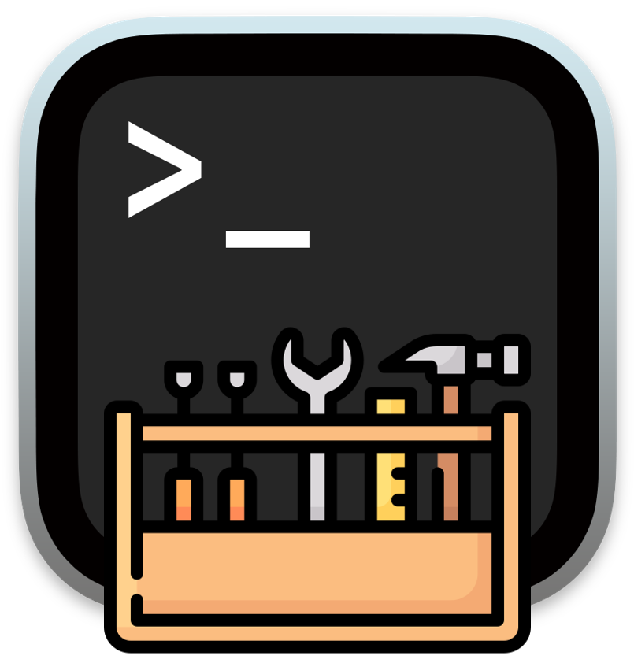
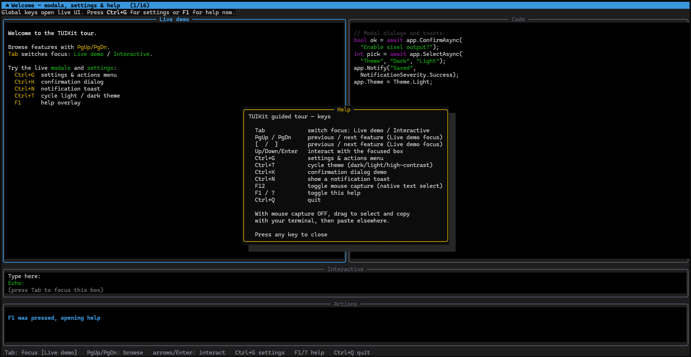
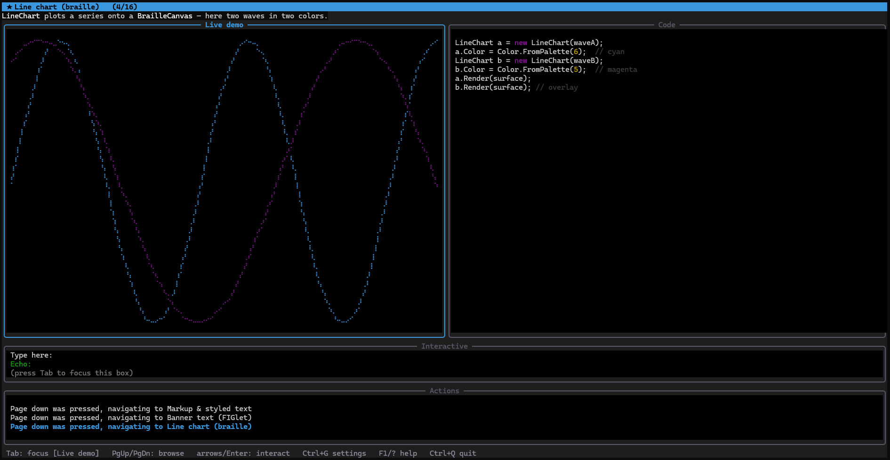
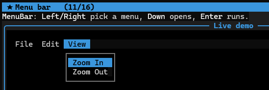
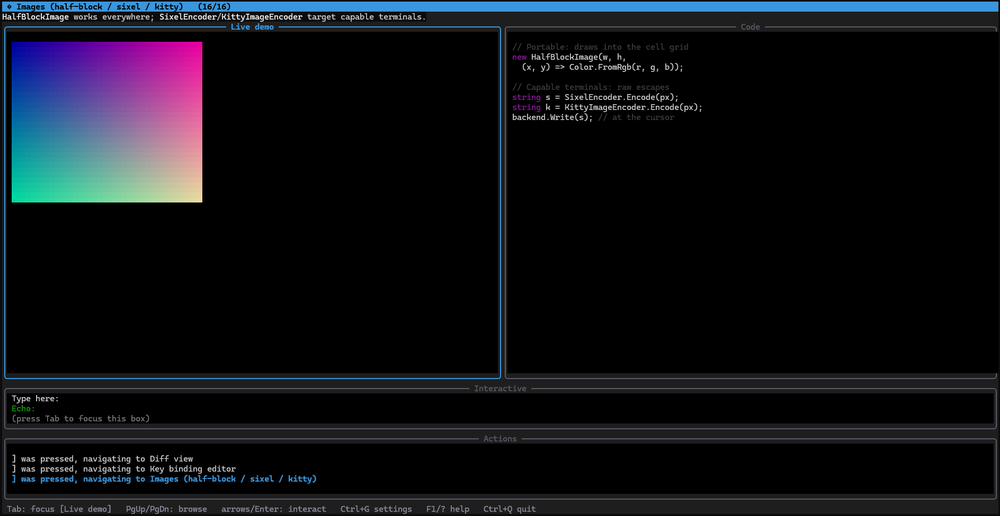

<div align="center">
  
</div>

# TUIKit

[](https://www.nuget.org/packages/TUIKit/) [](LICENSE.md) [](https://dotnet.microsoft.com/)

A concurrent, high-performance terminal UI framework for .NET. TUIKit lets you drop a multi-pane, live-updating interface into an ordinary console application - the kind of surface an AI agent harness needs: a streaming transcript on one side, tool output and telemetry on another, an input composer at the bottom, and modal dialogs on top of it all.

> **v1.12.0 - confirmation prompts and activity timelines.** Horizontal radio groups, Yes/No prompts with Left/Right selection, and connected workflow events with wrapping detail. Unicode and ASCII glyphs work through the existing terminal backends. See the [changelog](CHANGELOG.md).

**Quick links:** [Building Terminal Apps guide](BUILDING_TERMINAL_APPS.md) · [Runnable example](src/TUIKit.Example) · [Changelog](CHANGELOG.md) · [Contributing](#contributing-issues-and-discussions)

> **See it live** in ~30 seconds - a self-describing guided tour of every feature, with the code beside each one:
>
> ```bash
> dotnet run --project src/TUIKit.Example              # guided tour
> dotnet run --project src/TUIKit.Example -- --contract # the interaction-contract demo
> ```

<details>
<summary><strong>Screenshots</strong></summary>

<br />

<a href="assets/ss1.png"></a>

<a href="assets/ss2.png"></a>

<a href="assets/ss3.png"></a>

<a href="assets/ss4.png"></a>

</details>

## What it is

TUIKit is a library, not an application. You reference it, describe a layout as a set of rectangles, bind panes to those rectangles, register some keybindings, and hand control to a host that owns the render and input loops. It is built for the case where **several threads write at once**: a background worker can call `pane.WriteLine(...)` while the render thread repaints, and TUIKit handles the ordering, the diffing, and the minimization of escape sequences for you.

It multi-targets `netstandard2.0`, `net8.0`, and `net10.0`. The modern targets are dependency-free; `netstandard2.0` pulls in a small compatibility shim so the same code runs on .NET Framework, Mono, and Unity.

## What it does

- **Developer-defined regions.** Declare any number of rectangles, each with its own resize behavior - fixed, edge-anchored, stretch, or proportional - plus per-rectangle padding and an optional background (an explicit color or a named theme role, so a sidebar or status strip is tinted and restyles with the theme). TUIKit reflows them when the window changes and shows a "terminal too small" screen when it can't fit.
- **Thread-safe, mutable content.** Any thread may write to any pane; writes are FIFO per pane. Lines can be updated in place, so a tool call goes `running…` → `done (1.2s)` and a progress bar advances without redrawing the world.
- **Streaming with a smart scroll lock.** Scroll up to detach from the live tail; return to the bottom to re-attach. A "N new below" marker counts what you're missing and takes you back when clicked. The same `TailFollow` rules drive growing lists (`ListView.TailFollow` with `Append`): selecting a row never stops following, only scrolling away does.
- **Rich text.** A fluent styled-text builder, inline markup (`[bold red]…[/]`), a width-aware Markdown engine (GFM tables whose columns are sized from their content and stack into records when space runs out, nested lists and quotes that keep their indent when they wrap, highlighted code, nested emphasis and links, all configurable at render time through `MarkdownRenderOptions`), word/character wrapping, and correct Unicode column width for CJK, combining marks, and emoji grapheme clusters.
- **Enhanced input.** A byte decoder for UTF-8, control keys, arrows, function keys, the Kitty/CSI-u protocol, SGR mouse, and bracketed paste - routed through a central command table with scopes, multi-key chords (`Ctrl+K Ctrl+T`), and a configurable Ctrl+C policy. Carriage return (`Enter`) and line feed (`Ctrl+J`) decode distinctly, so you can bind `Ctrl+J` as a newline chord that works even where the terminal can't report `Shift+Enter`.
- **Mouse, links, and selection.** Full pointer support: click-to-focus, single/double/triple click synthesis, drag, vertical **and horizontal** wheel, and **hover** - any-motion tracking (on by default, with per-frame move coalescing) delivers `Enter`/`Leave` events synthesized from a per-frame hit-test map, so widgets highlight under the pointer. Terminal **focus reporting** (`TerminalFocusChanged`) lets an app dim itself when the window blurs. Virtual links get per-frame hit-testing, a security allowlist for auto-linkification, hover tracking (`LinkHovered` for status-bar URL previews), OSC 8 hyperlink emission, and keyboard link hints; text selection and OSC 52 clipboard copy work over SSH. A one-key toggle hands the mouse back to the terminal for native drag-select, and `MouseTrackingMode` drops to drag-only or off for chatty links. See [Mouse support by environment](#mouse-support-by-environment) for the exact matrix.
- **A host-owned interaction contract.** The host wires the interactive skeleton for you: a **focus ring** across bound focusable widgets (`Focus`, `FocusNext`/`FocusPrevious`, `FocusChanged`, `Tab` traversal, `FocusContext` that follows focus), an explicit **key-precedence chain** (modal → pre-filter → focus-scoped commands → focused-widget first refusal → global commands → fallback), **click-to-focus** and wheel routing from a per-frame hit-test map, and application-shell **dock layout helpers** (`DockTop`/`DockBottom`/`DockLeft`/`DockRight`/`Fill`). Focus is always visible when you want it: `HighlightFocusedRegion` gives the focused region a heavy frame without shifting content (neighbouring frames can share one line with proper tee and cross joins), `CurrentFocusPath` names every container between the region and the focused widget, and `BindKeyHints` makes a status bar list the keys that work for whatever has focus, hiding single-letter shortcuts while a text field would type them, and the keys a text field swallows (Enter and the arrows in an editor). A `/` hint can stay while typing (`KeyHint.WhileTyping`), and `?` Help can read `F1` Help instead (`WithTypingAlternative`). Hidden or empty widgets drop out of the Tab order, and focus resting on a widget that disappears moves to its neighbour on the next frame (`FocusScope.RepairFocus`). Toolbars and status chips can stay clickable without being Tab stops (`IFocusStop`). A focused frame that shares a line with a neighbour is drawn whole in its own weight, so it reads as one shape. It's all additive - the raw `KeyReceived`/`MouseReceived`/`RenderOverlay` hooks still work.
- **Modals, notifications, and prompts.** A focus-trapping modal stack with awaitable, **typed** results (`ShowAsync<T>`, plus `ConfirmAsync` / `PromptAsync` / `SelectAsync`), a reusable `DialogModal` base that auto-sizes a centered box with a title and footer hint so custom dialogs stop hand-rolling geometry, a `MultiSelectModal<T>` for choosing several options, a `Post(Action)` loop scheduler for marshalling continuations back onto the UI thread, non-focus-stealing toasts, and a global focus manager for `Tab` order.
- **A broad widget toolkit.** Inputs (text field with masking and a reveal key for secrets, shell line-editing keys, prefill selection, a length limit, validation, and Enter to submit, multi-line editor with undo and a kill ring, checkbox, radio group, forms); selection (`CheckList<T>` multi-select, sortable virtualized `DataTable<T>`, tree, tabs, fuzzy finder, list); navigation (menu bar, file browser, scroll view, collapsible section, status bar); status and feedback (a `DefinitionList` labeled-value panel, `ActivityIndicator` working line, gauge, sparkline, progress bar, spinner, concurrent multi-task progress); a `Rule` divider; plus a user-editable key-binding editor.
- **Framed screens.** `FramedStack` frames every pane of a screen with shared lines, sizes them with `StackSize.Fixed`, `Weighted`, and `Min`, nests into grids, routes clicks and Tab between panes, and opens an overlay drawer that takes focus. `TabStrip` is a tab strip without content for apps that route tab content themselves, and bracket markers (`TabFocusPrefix`/`TabFocusSuffix`) keep tabs in place when focus moves.
- **Nested focus, change events, and form controls.** `FocusScope` and `IFocusContainer` give hierarchical focus: tabs, split panes, scroll views, collapsible sections, button rows, and forms route keys to their children and Tab moves through nested scopes. Inputs and pickers raise change events (also for programmatic sets) and support disabled and read-only states; forms hide rows, track dirty state (by events or by value snapshots that notice a revert), draw sections, hints, and per-field errors, and submit and cancel with keys or buttons; a `Wizard` runs multi-step flows. `Button`, wrapping `ButtonRow`, `Dropdown<T>`, `ComboBox`, `ContextMenu`, `Badge`, and pointer tooltips (`ITooltipProvider`) round out the controls, and `DataTable<T>` offers sized and aligned columns, typed sorting with header indicators and header clicks, server-side sort, multi-select, per-cell styles, local and server paging with load and error states (`DataTableLoader<T>` does the async plumbing), and column keys, visibility, a chooser, and a keyboard column cursor.
- **Theme-aware widgets and a notification center.** Opt in with `ApplyThemeToWidgets` and every bound widget, modal, toast, tooltip, and Markdown style follows the active theme. Toasts can carry titles and action buttons, wrap over several lines, be dismissed by click, coalesce repeats into one toast with a count (by action key or label, so a fresh lambda per call still coalesces, or by an explicit `CoalesceKey`), carry a text severity label so severity is never color alone, leave room for a header bar (`TopOffset`), run the newest toast's action from a key (`InvokeLatestNotificationAction`), and stay in a notification history (`ShowNotificationHistoryAsync`). A built-in command palette (`ShowCommandPaletteAsync`) and key-help overlay (`ShowKeyHelpAsync`) work from a `CommandRegistry`.
- **Selection and editing lists.** Generic `ListView<T>` and `FuzzyList<T>` return the selected object (not a string), and `FuzzyList<T>` adds detail text, disabled entries, checkboxes, and a query-driven items provider for pickers; `ActionListView<T>` gives rows keyboard actions with a typed result, and `ReorderableList<T>` moves and removes items in place. Custom-drawn rows can carry clickable `InlineButton`s resolved by a `ClickRegionMap<TAction>`, which stays correct when the content scrolls.
- **Command surfaces and typeahead.** A `CommandRegistry` drives key bindings, a grouped menu bar, a fuzzy command palette, and a `/slash` router from one command list, and an `AutocompleteOverlay` (with a pluggable `ISuggestionProvider`) shows caret-anchored suggestions for any text input.
- **Streaming and text helpers.** A `StreamingTranscript` that projects streamed text and keyed in-place status lines onto a pane (finalizing each block as Markdown, or with `RenderOptions` set, as one block that reflows with the pane), plus `HintText` footer wrapping, `ColumnFormatter` column alignment, and a `SubmitKeyResolver` that settles the cross-terminal Enter-vs-newline question for multi-line editors.
- **Charts, diffs, and images.** Braille line and bar charts, a sparkline, and three distribution widgets - a `BoxPlotChart` (horizontal box-and-whisker over a caller-supplied five-number summary such as min / avg / p95 / p99 / max), a `Histogram` (bucketed frequency with the eighth-block ramp, live via `Push`), and a `HeatMap` (a grid of cells shaded by magnitude) - plus a diff viewer with syntax highlighting, FIGlet-style banners, a color picker, and image rendering - half-block on any terminal, sixel or kitty where supported.
- **Text-to-ASCII-art.** A font engine (`TUIKit.Ascii`) that turns text into large multi-row art with faithful FIGlet layout - full-width, kerning, and the six horizontal smushing rules. `AsciiFontLibrary.Default` ships 134 built-in fonts (Standard, Slant, the Small family, Doom, Colossal, ANSI Shadow, Sub-Zero, and more); `AsciiArtText` drops any of them into a layout, and `FigletFontLoader` loads your own `.flf`/`.tlf` files. Fonts with restrictive licensing are not bundled.
- **Reactive and animated.** Thread-safe `Observable<T>` one-way data binding, and deterministic, tick-driven animation (`Easing`, `Tween`, `FrameTimer`) that replays identically in tests.
- **Theming and diagnostics.** Dark, light, and high-contrast themes with an ASCII-border fallback; a debug overlay; frame statistics; and input record/replay.
- **Full-viewport, flicker-free rendering.** A double-buffered diff renderer repaints only changed rows and coalesces SGR runs; **synchronized output** (DEC mode 2026) presents each frame atomically so fast streams never tear; a persistent **full-repaint mode** covers backends that drop incremental updates; and a cross-platform **`SuspendAsync`** shell-out hands the terminal to an external editor or pager and restores the alternate screen afterward. The terminal is restored on every exit path - clean quit, Ctrl+C, or unhandled exception.
- **Headless rendering and testing.** Render to an in-memory cell buffer and assert it as text or cell by cell (`CaptureFrame`, `WidgetTester.CellAt`). Drive real keys and mouse input through the same parser and hit map a user exercises (`HeadlessBackend.FeedKey`, `FeedClick`, `FeedWheel`, `FeedDrag`), and sweep every focus stop with `FocusAudit` to catch invisible focus, Tab traps, and asymmetric traversal. A `HeadlessBackend` with `ClaimsTerminal = false` does not take the process's one terminal slot, so many headless apps can run at once, for example in parallel tests. It's how TUIKit tests itself, and it's a shipped feature so you can test your own UI.

## Why use it

Most console UI libraries assume a single-threaded, immediate-mode loop and a rigid split layout. An agent harness breaks both assumptions. Output arrives in a flood of tokens from one thread while tool calls mutate their status lines from another, the operator scrolls back through history without losing the live tail, and a confirmation dialog can appear at any moment.

TUIKit is designed around that reality. Panes are retained objects that own their state, so a background thread writing to one is natural rather than a special case. Rendering is a double-buffered diff that emits only the cells that changed and coalesces styling, so a 100 Hz token stream doesn't turn into 100 full repaints. And because the whole thing renders into an in-memory buffer, you can test your interface deterministically instead of eyeballing a terminal.

If you are building a chat client, an agent control panel, a log viewer, a deployment dashboard, or any long-running console tool where content moves on its own, TUIKit gives you the concurrency model and the rendering discipline to do it without reinventing them.

### How it compares

- **vs. [Spectre.Console](https://spectreconsole.net/):** Spectre excels at rich one-shot output - tables, prompts, and progress in a linear program. TUIKit is a **retained, concurrent, full-screen** framework: panes are long-lived objects that many threads write to while a diffing renderer repaints, which is what a live dashboard or agent harness needs.
- **vs. [Terminal.Gui](https://github.com/gui-cs/Terminal.Gui):** Terminal.Gui is a classic desktop-style widget toolkit (windows, menus, dialogs). TUIKit shares much of that toolkit but is oriented toward **streaming content and headless snapshot testing** - you render into an in-memory buffer and assert it as text, so your UI is unit-testable rather than eyeballed.
- **Dependency-free** on modern targets, multi-targeting `netstandard2.0`/`net8.0`/`net10.0`, and self-contained Unicode/width handling (no `System.Text`-heavy detours, no native deps).

## How it works

TUIKit is a stack of small, testable layers. Each one is useful on its own and none of them reach into the internals of the layer above.

1. **Terminal backend** (`ITerminalBackend`) - the raw sink for output bytes and source for input bytes. `ConsoleBackend` drives a real terminal (VT enabled via `SetConsoleMode` on Windows, in-process `termios` raw mode on Unix). `HeadlessBackend` captures everything in memory for tests.
2. **Renderer** (`TerminalRenderer`) - composes a frame into a back buffer, diffs it against what's on screen, and emits the minimal set of escape sequences to reconcile them. Truecolor is quantized to 256/16 colors when the terminal can't do better.
3. **Layout** (`Layout`, `Region`) - resolves each region's rectangle from its constraints and padding for the current surface size, and derives the minimum size below which it shows the block screen.
4. **Content** (`Pane`) - a thread-safe, scrolling, mutable text surface with a capped ring buffer, mutable line handles, and the smart scroll lock.
5. **Input** (`InputParser`, `CommandRoutingTable`) - decodes raw bytes into key, mouse, and paste events and routes them by scope, honoring multi-key chords and the Ctrl+C policy.
6. **Host** (`TuiApplication`) - ties it together: it owns the render and input loops, drives the focus ring and the key-precedence chain, hit-tests the mouse for click-to-focus, wheel routing, and hover Enter/Leave synthesis (with move coalescing so any-motion tracking stays cheap), stamps multi-click counts on presses, dispatches commands and terminal focus changes, manages the modal stack and notifications, restores the terminal on exit, and degrades to plain line output when stdout isn't a TTY.

## Installation

```bash
dotnet add package TUIKit
```

Or add it to your project file:

```xml
<PackageReference Include="TUIKit" Version="1.12.0" />
```

## URL and file hyperlinks

```csharp
using System;
using System.IO;
using TUIKit;
using TUIKit.Terminal;

StyledText website = StyledText.Link(
    "Visit the docs", new Uri("https://example.com/docs"));
StyledText file = StyledText.Link(
    "Open settings.json", new Uri(Path.GetFullPath("settings.json")));

StyledConsole console = StyledConsole.ForStandardOutput();
console.WriteLine(website.Append(" | ").Append(file));
// For a full-screen app, use pane.WriteLine(website) or surface.DrawStyledText(...).
```

TUIKit emits standard [OSC 8 hyperlinks](https://iterm2.com/documentation-escape-codes.html), so
native activation and the browser/file association belong to the terminal. Use the terminal's
link-click modifier; if mouse capture interferes, release capture (F12 in the example tour).
For ordinary clicks while capture is on, subscribe to `app.HyperlinkActivated` and open the supplied
`Uri` using your application's policy. This path works even without OSC 8 support. The example tour
handles it using `Process.Start(new ProcessStartInfo(uri.IsFile ? uri.LocalPath : uri.AbsoluteUri)
{ UseShellExecute = true })`, so ordinary clicks work on macOS, Windows, and Linux. The library itself
does not launch anything. Application-handled file links open on the machine running the app;
native terminal file links open through the terminal client.
`new Uri(Path.GetFullPath(path))` encodes local Windows, macOS, and Linux paths, including spaces.
Absolute `http`, `https`, `file`, and `mailto` URIs are supported. Relative URIs, other schemes, and
raw control characters are rejected. Files open through the terminal client's handling; over SSH a
remote path may require terminal-specific remote-file integration.

`console.Hyperlinks` and `app.Hyperlinks` default to `HyperlinkMode.Auto`. Auto detects known terminals
and disables inline hyperlinks for redirected/custom writers. Detection is independent of `NO_COLOR`.
Use `HyperlinkMode.Always` for a known-compatible tmux session or explicit writer, and `Never` to disable
OSC 8. Auto is conservative for unknown terminals and multiplexers; supporting terminals and their
settings still determine whether activation works. Unsupported output retains the label; width-aware
Markdown can additionally show destinations with `MarkdownRenderOptions.ShowLinkUrls = true`.

Targets live in immutable `CellStyle.Hyperlink` values, so no registration is needed for these helpers.
Existing registry-based `LinkId` cells also work in full-screen apps through `app.Links`; standalone
`TerminalRenderer` users can provide `LinkResolver`. Command-only links remain application actions.
Low-level callers can explicitly enable targets with `AnsiText.Render(text, depth, hyperlinks: true)`
or `InlineRenderer.ToAnsiLines(buffer, depth, hyperlinks: true)`; `TerminalColorDepth.None` suppresses
color while these overloads can still emit OSC 8.

Try `dotnet run --project src/TUIKit.Example -- --links-once`, or add `--links-always` to force OSC 8.
The default guided tour also includes a **URI hyperlinks** page. Its file link targets the example
README bundled beside the executable on build and publish, so it works from any launch directory.
For your own file links, ensure the target exists: constructing a file URI does not create the file.


## Quick start

A two-pane app - a scrolling log above a prompt line - with a background thread streaming into it and `Ctrl+Q` to quit. One call (`TuiApp.RunAsync`) owns the terminal, the render loop, and the input loop:

```csharp
using System.Threading;
using System.Threading.Tasks;
using TUIKit;
using TUIKit.Content;
using TUIKit.Hosting;

await TuiApp.RunAsync(app =>
{
    // Two rectangles: a log that fills the space above a 3-row prompt.
    Pane log = app.AddPane("log", r => r.FillWidth().FillHeight(0, 3));
    app.AddPane("prompt", r => r.FillWidth().BottomAnchored(0, 3));

    // Bind a chord straight to an action.
    app.Bind("Ctrl+Q", app.Quit);

    // Any thread may write to a pane; ordering is FIFO per pane.
    _ = Task.Run(async () =>
    {
        for (int i = 1; i <= 100; i++)
        {
            log.WriteLine(Text.From($"event {i}").Green());
            await Task.Delay(50);
        }
    });
},
CancellationToken.None);
```

Prefer to wire things up by hand? Construct a `ConsoleBackend` and a `TuiApplication`, set `app.Layout`, `BindPane`, register commands, and `await app.RunAsync(...)` yourself - the [Building Terminal Apps guide](BUILDING_TERMINAL_APPS.md) shows both paths.

### Focus and key hints

Users should always know where their keys will go. Turn on the focus frame, give regions borders, and bind a status bar to the focus path:

```csharp
await TuiApp.RunAsync(app =>
{
    app.HighlightFocusedRegion = true; // the focused region draws a heavy frame

    ListView<string> files = app.AddWidget("files", new ListView<string>(),
        r => r.ProportionalWidth(0, 0.4).FillHeight(0, 1).WithBorder(BorderStyle.Rounded, "Files"));
    files.SetItems(new[] { "README.md", "Program.cs" });
    app.AddWidget("search", new TextField { Placeholder = "Search" },
        r => r.ProportionalWidth(0.4, 0.6).FillHeight(0, 1).WithBorder(BorderStyle.Rounded, "Search"));

    StatusBar status = app.AddWidget("status", new StatusBar(), r => r.FillWidth().BottomAnchored(0, 1).WithPadding(0));
    app.BindKeyHints(status).AddAppHint("q", "Quit"); // hidden while the search field has focus

    app.Bind("Ctrl+Q", app.Quit);
}, CancellationToken.None);
```

With the list focused the bar reads `Up/Down Move   Home/End First/last   Q Quit`; press `Tab` into the search field and it reads `Tab Next field`, because `q` would type a letter there. Widgets describe their own keys through `IKeyHintSource`, and `app.CurrentFocusPath` tells you which containers hold focus.

When a screen has more structure than a few regions, frame its panes with a `FramedStack`. Neighbours share one line, the focused pane is drawn whole, and Tab and clicks move between panes:

```csharp
ListView<string> channels = new ListView<string>();
ListView<string> transcript = new ListView<string>();
TextEditor composer = new TextEditor { LeaveHint = new KeyHint("Tab", "Leave composer") };

FramedStack right = new FramedStack(SplitOrientation.Vertical)
    .Add(transcript, StackSize.Weighted(1), "Transcript")
    .Add(composer, StackSize.Fixed(3), "Composer");
FramedStack screen = new FramedStack(SplitOrientation.Horizontal)
    .Add(channels, StackSize.Weighted(1, 12), "Channels")
    .Add(right, StackSize.Weighted(3));
screen.FrameOptions.TitleAlignment = TitleAlignment.Left;

ListView<string> pinned = new ListView<string>();
app.Bind("F2", () => screen.Overlay = screen.Overlay == null ? pinned : null); // a drawer that takes focus
```

The nested stack joins its lines with the outer one, so the two form a grid with proper tees.

### Text entry, pickers, and server-backed tables

A login, settings, or create screen needs more from a text field than typing. Every feature below is opt-in, so a 1.7 field behaves the same until you turn it on:

```csharp
TextField user = new TextField { UseLineEditingKeys = true };  // Ctrl+A/E, Ctrl+U/K, Ctrl+W, Ctrl+Left/Right
user.Value = settings.LastUser;
user.SelectAll();                                               // the first key replaces the remembered value

TextField token = new TextField { MaskChar = '*', MaxLength = 64, RevealKey = KeyChord.Parse("ctrl+r") };
token.Validator = v => v.Length < 20 ? "Paste the whole token" : null;
token.Submitted += (s, e) => { if (token.Validate()) SignIn(user.Value, token.Value); };  // Enter, only with a handler

app.RoutePasteToFocus = true;                                   // a paste lands in the focused field
```

`FuzzyList<T>` covers pickers and command palettes: secondary text, entries that cannot be chosen, checkboxes, and results computed from the query.

```csharp
FuzzyList<Package> picker = new FuzzyList<Package>(packages, p => p.Name)
{
    Detail = p => p.Version,                                    // drawn after the name, truncated first
    IsEnabled = p => !p.Deprecated,                             // listed dim; navigation skips it
    MultiSelect = true,                                         // Space checks, Ctrl+A checks all
    ItemsProvider = q => Search(q),                             // e.g. add a "Create <query>" entry
};
picker.ItemActivated += (s, p) => Install(picker.CheckedItems);
```

`DataTable<T>` pages a list that lives on a server, shows when it is loading or failed, and lets the user pick columns. `DataTableLoader<T>` does the async part: it cancels a superseded fetch, ignores late results, and posts results back to the UI thread.

```csharp
DataTable<Job> jobs = new DataTable<Job>()
    .Column("id", "Id", j => j.Id.ToString(), sortable: true)   // the key is what the server sorts by
    .Column("status", "Status", j => j.Status, sortable: true);
jobs.PagingMode = DataTablePagingMode.Remote;                   // "Showing 26-50 of 248. Page 2 of 10."
jobs.RetryKey = KeyChord.Parse("f5");                           // shown with the error
jobs.NextPageKey = KeyChord.Parse(">");
jobs.PreviousPageKey = KeyChord.Parse("<");

DataTableLoader<Job> loader = new DataTableLoader<Job>(jobs,
    async (request, ct) => await api.PageAsync(request.Offset, request.PageSize, request.SortColumnKey, request.SortAscending, ct),
    app.Post);
loader.Reload();

MultiSelectModal<DataColumn<Job>> chooser = jobs.CreateColumnChooser("Columns");
await app.ShowAsync(chooser);
jobs.ApplyColumnChooser(chooser);                               // keys make a saved layout possible
```

### Forms and multi-step flows

A settings or create dialog gets headings, hints, errors under each field, Save and Cancel, and an unsaved-changes flag that clears when the user puts a value back. All of it is opt-in:

```csharp
Form form = new Form { LabelPlacement = FormLabelPlacement.Left, ShowFieldErrors = true, ShowButtons = true };
form.AddSection("Project");
TextField prefix = new TextField();
form.Add("Branch prefix", prefix, () => prefix.Value.EndsWith("/") ? null : "End it with /");
form.SetFieldHint(0, "Used as the prefix for new work branches");
form.SubmitKey = KeyChord.Parse("ctrl+s");
form.CancelKey = KeyChord.Parse("escape");
form.DirtyTracking = FormDirtyTracking.Snapshot;          // type, then delete: clean again
form.SubmitRequested += (s, e) => { Save(); form.MarkClean(); };   // raised only when every field is valid
form.CancelRequested += (s, e) => { if (form.IsDirty) AskToDiscard(); };
```

`Wizard` runs a setup or import flow: a header and step list, per-step validation, optional steps, steps that apply only after an earlier answer, and Back, Skip, Next, Finish, and Cancel. `WizardModal` shows it as a dialog whose completion tells you how it ended:

```csharp
Wizard wizard = new Wizard(new[]
{
    new WizardStep("Project", projectForm) { Validate = () => name.Value.Length == 0 ? "Name it first" : null },
    new WizardStep("Repository", urlField) { IsApplicable = () => import.Checked },
    new WizardStep("Extras", notesField) { Optional = true },
});
WizardOutcome? outcome = await app.ShowAsync<WizardOutcome>(new WizardModal("New project", wizard));
```

### Confirmation prompts and activity timelines

`RadioGroup` defaults to its existing vertical layout. Set `Orientation` to
`RadioGroupOrientation.Horizontal` for Left/Right navigation on one row; Home/End select
first/last. `SelectedMarker`, `UnselectedMarker`, and `Separator` customize its appearance:

```csharp
RadioGroup choice = new RadioGroup(new[] { "Yes", "No" })
{
    Orientation = RadioGroupOrientation.Horizontal,
    SelectedMarker = "●",
    UnselectedMarker = "○",
    Separator = " / "
};
```

`ConfirmPrompt` adds the question, marker gutter, and completion lifecycle. It defaults to No;
pass `true` for Yes. Arrows or a mouse click change the selection without submitting. Enter
submits; Escape cancels. `IsCompleted` distinguishes a pending prompt from a cancelled one;
`Result` is `true`/`false` for a submitted answer and null for cancellation. `Completed` fires
once per interaction; `Reset(defaultValue)` starts another. A completed prompt shows its answer.

```csharp
ConfirmPrompt prompt = new ConfirmPrompt("Proceed with installation?", true);
prompt.Completed += (sender, args) =>
{
    if (prompt.Result == true)
        StartInstallation();
};
prompt.ApplyTheme(app.Theme);
```

`ActivityTimeline` draws an ordered step log with a connecting gutter. `Add` returns an entry
whose `Text`, `Status`, and optional `Detail` can be updated on the UI loop. Primary text and
detail wrap at the available column width, preserving Unicode graphemes and explicit newlines.
`Spacing` defaults to one connecting row; zero makes the timeline compact.

```csharp
ActivityTimeline timeline = new ActivityTimeline();
timeline.Add("Repository cloned");
timeline.Add("Found 1 skill");
ActivityEntry skill = timeline.Add("Skill: humanizer", ActivityStatus.Active);
app.Post(() =>
{
    skill.Status = ActivityStatus.Completed;
    skill.Detail = "Installed successfully.";
});
```

| Status | Unicode | ASCII |
| --- | --- | --- |
| Pending | ○ | o |
| Active | ● | * |
| Completed / informational | ◇ | + |
| Failed | × | x |

Both new widgets support `ApplyTheme(theme)` and `UseAsciiGlyphs`. Applying a theme sets the
glyph preference from `UseAsciiBorders`; set `UseAsciiGlyphs` afterward to override it for a
terminal/font. Status and selection remain distinguishable without color. The existing UTF-8,
VT output and normalized input backends handle Windows, macOS, and Linux; no new native backend
or font dependency is required.

These widgets use the UI loop. Marshal background updates through `app.Post(...)`. They render
inside their assigned surface and clip at its bounds. For long timelines, use `ScrollView` with
an explicit content size and refresh it with `SetContentSize` as entries or width change; measure
the timeline with the content width and a sufficiently large height. They do not manage an
inline shell prompt session or commit completed prompts to terminal scrollback.

The guided tour demonstrates them on **Confirmation prompts** (page 43) and **Activity timeline**
(page 44). See the [example guide](src/TUIKit.Example/README.md) for keys and snapshot commands.

### Diffs and activity calendars

`DiffView.FromUnifiedDiff` shows a diff produced elsewhere, such as `git diff` output, a code review API, or a patch file, with styled file and hunk headers, the files it covers, line numbers, and search:

```csharp
DiffView diff = DiffView.FromUnifiedDiff(patch, "csharp");
diff.UseFileKeys = true;        // ] and [ jump between files; diff.Files lists them
diff.ShowLineNumbers = true;    // old and new numbers from the @@ headers
diff.SetSearch("port");         // F3 and Shift+F3 move between matches
string copy = diff.PlainText;   // the patch as given
```

`CalendarHeatMap` is a contribution calendar the user can move through, and `HeatMap` underneath it gains the same selection, levels, legend, and wide cells for any grid:

```csharp
CalendarHeatMap activity = new CalendarHeatMap { Summary = total + " commits" };
activity.SetData(yearAgo, today, commitsByDay);           // keys with a time part count for their day
activity.LevelGlyphs = new[] { " ", ".", ":", "+", "#" }; // readable without color
activity.DateActivated += (s, day) => ShowCommits(day);  // Enter or a double click
```

### Markdown

Model replies are Markdown, and most of their structure only works at a known width. `Pane.WriteMarkdown` commits a block that is laid out at the pane's width every time it renders, so a table sizes its columns from its cells and reflows when the terminal is resized:

```csharp
Pane transcript = new Pane("transcript");
transcript.WriteMarkdown(reply); // default options: Unicode borders, wrapping, theme-neutral colors
```

Every visual decision is an option, set when you render:

```csharp
MarkdownRenderOptions options = new MarkdownRenderOptions
{
    MaxWidth = 100,                          // keep prose readable in a wide pane
    Overflow = MarkdownOverflow.Wrap,        // or Truncate (with Ellipsis) or Clip
    Styles = MarkdownStyles.FromTheme(Theme.Dark)
};
options.Table.Glyphs = MarkdownTableGlyphs.Rounded;     // Light, Heavy, Double, Ascii, None, or your own
options.Table.MinColumnWidth = 4;
options.Table.MaxColumnWidth = 40;
options.Table.CellOverflow = MarkdownOverflow.Wrap;
options.Table.Fallback = MarkdownTableFallback.Stack;   // when the columns cannot fit
options.Styles.TableHeader = CellStyle.Default.WithForeground(Color.FromPalette(6)).WithAttribute(CellAttributes.Bold, true);
options.Styles.TableFirstColumn = CellStyle.Default.WithForeground(Color.FromPalette(3));

PaneLineHandle block = transcript.WriteMarkdown(reply, options);
block.UpdateMarkdown(reply + more);                     // stream into the same block

IReadOnlyList<StyledText> rows = MarkdownRenderer.Render(reply, 72, options);  // or render rows yourself
int natural = MarkdownRenderer.MeasureWidth(reply, options);                   // size a modal from content
MarkdownView help = new MarkdownView(helpText, options);                       // or show it as a widget
```

Columns get their natural width when the table fits. When it does not, short columns (keys, numbers, status words) keep their width and the widest prose column wraps at word boundaries. When even each column's longest word cannot fit, or a row would wrap past `Table.MaxRowLines`, the table becomes `Header: value` records:

```text
╭────────────────┬──────────┬──────┬───────────────────────╮     Option: Redis cache
│ Option         │ p99 (ms) │ Cost │ Notes                 │     p99 (ms): 12
├────────────────┼──────────┼──────┼───────────────────────┤     Cost: $$
│ Redis cache    │       12 │  $$  │ Fastest, but another  │     Notes: Fastest, but another service to
│                │          │      │ service to run and    │       run and page on
│                │          │      │ page on               │     ────────────────────────────────────────
│ None           │      240 │  -   │ Simplest              │     Option: None
╰────────────────┴──────────┴──────┴───────────────────────╯     ...
```

`StreamingTranscript.RenderOptions` streams a reply into one reflowing block and holds back a half-received table row until its newline arrives, and a table header until its delimiter row arrives. If you stream into your own widget, `MarkdownRenderer.StreamingPrefix` applies the same rule. The 1.5 line-by-line `MarkdownRenderer.Render(string)` is unchanged.

`MarkdownView` is a full reader for help pages, release notes, and logs. Everything below is opt-in, so a 1.6 view looks and behaves the same until you turn it on:

```csharp
MarkdownView view = new MarkdownView(changelog, options)
{
    IsFocusStop = true,       // Tab reaches it; Up/Down, PgUp/PgDn, Home/End scroll; hints show while focused
    UseThemeStyles = true     // theme colors without theme backgrounds, ASCII glyphs on ASCII themes
};
view.SetSearch("redis");      // highlights matches; FindNext/FindPrevious or F3/Shift+F3 move between them
view.TailFollow.Mode = TailFollowMode.FollowAtBottom;  // a growing document stays at its end
view.Markdown = changelog + newEntry;                  // "N new below" if the reader scrolled up

// Markdown in your own widgets: lay each block out once per width, not once per frame.
MarkdownRenderOptions themed = options.WithTheme(app.Theme);   // call once per theme change and keep it
MarkdownLayoutCache cache = new MarkdownLayoutCache();
IReadOnlyList<StyledText> bubble = cache.GetRows(message, width, themed);
string shown = MarkdownRenderer.StreamingPrefix(receivedSoFar); // safe to lay out while text still arrives
```

`WithTheme` keeps your layout settings and any styles a theme does not define (such as a key-column style), and it never changes the instance you call it on. The cache compares options by reference, so reuse the themed instance rather than calling `WithTheme` every frame.

## Example application

A complete, runnable demo lives in [`src/TUIKit.Example`](src/TUIKit.Example) - a simulated **agent control harness** that exercises every major capability against a fake agent (no network, no model), so it is deterministic and self-contained. Its README carries a [capability-coverage matrix](src/TUIKit.Example/README.md) mapping each library feature to the exact interaction that demonstrates it.

### Walkthrough

1. **Run it.**

   ```bash
   dotnet run --project src/TUIKit.Example
   ```

   You land in a full-screen harness: a header bar, a streaming transcript on the left, a tool panel and live telemetry on the right, a bordered composer along the bottom, and a footer of shortcuts.

2. **Watch it stream.** The simulated agent streams a Markdown reply into the transcript from a background thread, a few characters at a time - headings, bold, lists, a table, a block quote, a fenced code block, and a link. The reply is one reflowing block, so resizing the window re-fits the table, and each frame shows only `MarkdownRenderer.StreamingPrefix` of what has arrived, so the table never flashes as text; the telemetry `reply` row says how much is being held back. Meanwhile a tool call runs and its status line mutates from `running` to `done (0.9s)` in place. The telemetry panel updates a gauge, a sparkline, a progress bar, and a table every frame.

3. **Press `F1` (or `?`).** A help overlay lists every keybinding. The demo documents itself.

4. **Type into the composer and press `Enter`.** Your message is echoed into the transcript. `Alt+Enter` inserts a newline; the composer is a full multi-line editor with undo/redo (`Ctrl+Z` / `Ctrl+Y`) and a kill ring (`Ctrl+K` / `Ctrl+U`).

5. **Scroll with `PageUp` / `PageDown`.** Scrolling up detaches the transcript from the live tail - the footer shows `detached N new` - and returning to the bottom re-attaches it. The mouse wheel scrolls whichever pane is under the cursor.

6. **Open the command palette with `Ctrl+P`.** A list widget in a modal; choose an action with the arrow keys and `Enter`. `Ctrl+G` opens a settings form with a radio group, a checkbox, and a text field, with `Tab` moving focus between them. `Ctrl+L` raises a confirmation dialog ("the agent wants to run `rm -rf build/`") whose result drives a toast.

7. **Cycle the theme with `Ctrl+K Ctrl+T`** (a two-key chord) and toggle the debug overlay with `Ctrl+D` to see every region's outline and the frame timing. High-contrast mode switches borders to ASCII.

8. **Quit.** `Ctrl+Q` exits cleanly and restores your terminal. `Ctrl+C` is configured to require a double-tap.

### Headless and non-interactive modes

The example renders a single frame to text without a terminal, which is how you would snapshot a UI in CI:

```bash
dotnet run --project src/TUIKit.Example -- --once          # print one frame to stdout
dotnet run --project src/TUIKit.Example -- --once --debug   # ... with the debug overlay
dotnet run --project src/TUIKit.Example -- --contract-once  # the interaction-contract demo frame
dotnet run --project src/TUIKit.Example -- --focus-once     # the focus showcase frame
dotnet run --project src/TUIKit.Example -- --focus-audit-once  # FocusAudit over the showcase; exit 1 on problems
dotnet run --project src/TUIKit.Example -- --markdown-once --width 60  # the Markdown sample at a width (--color, --ascii, --theme dark|light|contrast)
dotnet run --project src/TUIKit.Example -- --diff-once --numbers     # the bundled patch through DiffView.FromUnifiedDiff (--width, --color)
dotnet run --project src/TUIKit.Example -- --calendar-once --ascii    # a year of activity through CalendarHeatMap (--width, --color)
dotnet run --project src/TUIKit.Example | cat               # non-TTY -> plain line output
```

The **focus showcase** (`--focus`) is a small region-based app with left-titled focus frames, a tab view whose strip is its own focus stop, a status bar that follows focus, a log that follows new output, clickable inline buttons, and coalescing toasts with severity labels on `Ctrl+S` (`Ctrl+O` runs the newest toast's action). The guided tour's "Framed screens" and "Tab strip" pages show `FramedStack`, typing-aware hints, and `TabStrip`.

Your own tests can drive an app the same way. Render a frame, feed real input, pump, and assert on cells. Set `ClaimsTerminal = false` on the backend and any number of these apps can run in one process at the same time:

```csharp
HeadlessBackend backend = new HeadlessBackend(80, 24) { ClaimsTerminal = false };
using TuiApplication app = new TuiApplication(backend);
// ... build the layout and bind widgets ...
app.Start();
app.RenderOnce();                       // populates the hit map
backend.FeedClick(10, 3);               // real SGR mouse input
app.PumpInputOnce();
CellBuffer frame = app.CaptureFrame()!; // assert on glyphs and styles
FocusAudit.Run(app).ThrowIfProblems();  // every Tab stop visible, symmetric, and escapable
```

The **interaction-contract demo** (`--contract`) is the shortest path to seeing the host at work: a four-way dock shell (header, sidebar, editor, footer) built from real regions, a focus ring you drive with `Tab` or the mouse, a focus-scoped `Enter` that opens a file in the sidebar while `Enter` in the editor inserts a newline, a two-key theme chord, and a typed picker modal marshalled back onto the loop with `Post` - the whole app in ~120 lines of [`ContractDemo.cs`](src/TUIKit.Example/ContractDemo.cs).

## Terminal support

Interactive keyboard, rendering, and terminal restoration have been tested and validated on **Windows** (Windows Terminal), **macOS** (iTerm2), and **Linux**, including over an **SSH** session - the same raw-mode input path (native `SetConsoleMode` on Windows, libc `termios` on Unix) behaves identically across all three.

Tier-1, intended targets are Windows Terminal, iTerm2, Ghostty, WezTerm, Alacritty, and kitty - including over SSH and inside tmux. Terminals that can't report enhanced keys or truecolor (macOS Terminal.app, legacy conhost, PuTTY) run in a degraded mode with capability reporting rather than failing. When stdout is not a TTY, TUIKit emits plain line output instead of escape sequences.

### Mouse support by environment

TUIKit speaks one mouse dialect everywhere - SGR (DECSET 1006) extended reporting with button
tracking (1000), drag motion (1002), any-motion hover (1003), and focus reporting (1004). On
Windows, `ENABLE_VIRTUAL_TERMINAL_INPUT` makes the console translate native mouse input into the
same escape sequences a Unix terminal emits, so a single parser serves every platform. Modes a
terminal lacks are silently ignored, so every ⚠️/❌ below degrades gracefully - the app keeps
running and that feature simply doesn't fire.

| Environment | Click / drag / wheel | Hover / any-motion | Horizontal wheel | Focus in/out | Coords > 223 cols | Notes |
|---|---|---|---|---|---|---|
| Windows Terminal (Win 10/11) | ✅ | ✅ | ✅ | ✅ | ✅ | Primary Windows target; full VT input translation. |
| Legacy conhost (Win 10+) | ⚠️ | ⚠️ | ❌ | ❌ | ✅ | VT mouse translation is partial and version-dependent; TUIKit clears QuickEdit so events aren't swallowed by selection mode. Pre-VT conhost (Win 8.1 and earlier) gets no mouse at all. |
| macOS Terminal.app | ✅ | ⚠️ | ❌ | ⚠️ | ✅ | Drag tracking works; any-motion and focus reporting vary by macOS version - hover degrades to drag-only where 1003 is ignored. |
| iTerm2 | ✅ | ✅ | ✅ | ✅ | ✅ | Full support. |
| kitty / Alacritty / WezTerm / Ghostty | ✅ | ✅ | ✅ | ✅ | ✅ | Full support. |
| VTE terminals (GNOME Terminal, Tilix, xfce4-terminal) | ✅ | ✅ | ✅ | ✅ | ✅ | Full support. |
| xterm | ✅ | ✅ | ✅ | ✅ | ✅ | Reference implementation of every mode used. |
| tmux (`set -g mouse on`) | ✅ | ✅ | ⚠️ | ✅ | ✅ | Requires mouse enabled in tmux; tmux consumes some events for its own panes; horizontal-wheel forwarding depends on tmux version. With `mouse off`, no events reach the app. |
| GNU screen | ⚠️ | ❌ | ❌ | ❌ | ⚠️ | screen's pass-through is limited to basic tracking; treat as keyboard-first. |
| SSH (any client) | - | - | - | - | - | Transparent: capability is that of the *client* terminal emulator - the rows above apply to whatever the user runs locally. |
| WSL | - | - | - | - | - | Transparent: capability is that of the hosting console (usually Windows Terminal → full support). |
| Headless / redirected / CI | ❌ (by design) | ❌ | ❌ | ❌ | - | `IsInteractive` is false; no escape sequences are emitted. Tests inject synthetic events instead. |

Deliberately out of scope, and why:

| Capability | Why not |
|---|---|
| Pixel-precision coordinates (DECSET 1016) | Terminal support is spotty and TUIKit's rendering model is a cell grid; cell granularity is the reliable cross-platform contract. |
| Legacy mouse encodings (X10, UTF-8 1005, urxvt 1015) | SGR 1006 is ubiquitous in every terminal that reports the mouse at all today; the legacy encodings add ambiguity and coordinate-ceiling bugs for terminals that effectively no longer exist. Terminals without SGR fall back to keyboard-only operation via `TerminalCapabilities.SgrMouse`. |
| Mouse events outside the terminal window / global position | No terminal protocol reports the pointer outside the window. `Leave` is synthesized for transitions between widgets and out of bound regions. |
| Pointer cursor shape changes on hover | No standardized escape sequence with wide enough support to build API on. |
| Pre-Windows-10 consoles | No `ENABLE_VIRTUAL_TERMINAL_INPUT`, so no VT mouse translation exists to consume. |

### Text selection and copy

Set `TuiApplication.MouseTextSelectionEnabled = true` (off by default) to turn on a built-in
selection layer. While the mouse is captured, a left click-drag selects text within the region the
drag started in - the selection is clamped to that region, and a drag in another region replaces it,
so there is always at most one selection. `Ctrl+C` copies the selection to the clipboard over OSC 52
(so it works over SSH), clears it, and raises `TextCopied`; with nothing selected, `Ctrl+C` keeps
its configured policy. Selection reads back from the composited cell buffer, so it spans any bound
widget (transcript pane, text editor, sidebar, list) with no per-widget code and extracts wide
(CJK/emoji) glyphs correctly. Read the current selection with `GetSelectedText()`, inspect
`HasTextSelection`, restyle the highlight with `SelectionStyle` (reverse video by default), and clear
it with `ClearTextSelection()`. The layer is inert while mouse capture is off - so the F12 pattern
below hands the mouse back to the terminal for its own native selection - and while a modal is
active; a resize or scroll drops the selection.

## Observability

TUIKit emits metrics and traces through the standard .NET `System.Diagnostics` APIs. The meter and
activity source are both named `TUIKit`. The library has no exporter or SDK dependency and writes
nothing to the console; with no listener attached, emission is effectively free. Subscribe from your
host to send the data to Prometheus, Tempo, Grafana, or any OTLP backend:

```csharp
// Radiant (in your application, not the library)
RadiantSettings settings = new RadiantSettings("my-tui-app");
settings.Sources.AddMeter("TUIKit");
settings.Sources.AddActivitySource("TUIKit");
using (RadiantHost host = RadiantHost.Start(settings)) { /* run the app */ }

// or the OpenTelemetry SDK
Sdk.CreateMeterProviderBuilder().AddMeter("TUIKit") /* ... */;
Sdk.CreateTracerProviderBuilder().AddSource("TUIKit") /* ... */;
```

You get the following:

- Frame duration and per-stage time (`compose`, `diff`, `write`), with a last-success timestamp for stall alerts.
- Input events and key-routing decisions.
- Command outcomes, with spans that carry the command id.
- Post-queue depth and wait. A posted action's span joins the trace of the thread that posted it.
- Modal and toast counts.
- Session lifecycle and suspension.
- Clipboard and file-system integration calls.
- Errors grouped by component and type.

Per-frame spans are opt-in (`TuiKitTelemetry.TraceFrames`). There is also a master switch
(`TuiKitTelemetry.Enabled`). [`TELEMETRY.md`](TELEMETRY.md) has the full catalog of metrics, spans,
and labels, plus PromQL alerts and dashboard guidance.

## Building and testing

```bash
dotnet build src/TUIKit.sln

# Console test runner (colored, tabular output; exit code 0/1)
dotnet run --project src/Test.Automated
dotnet run --project src/Test.Automated -- --results results.json

# The same test descriptors through xUnit and NUnit
dotnet test src/Test.Xunit
dotnet test src/Test.Nunit
```

Tests are written with [Touchstone](https://github.com/jchristn/touchstone): one set of descriptors in `Test.Shared` runs identically through the console runner, xUnit, and NUnit. See [`docs/SURFACE_COVERAGE.md`](docs/SURFACE_COVERAGE.md) for the coverage audit.

## Contributing, issues, and discussions

Bug reports, feature requests, and questions are all welcome on GitHub:

- **File a bug or request a feature:** open an issue at [github.com/jchristn/TUIKit/issues](https://github.com/jchristn/TUIKit/issues). For a bug, include your OS, terminal, target framework, and the smallest snippet that reproduces it - a headless snapshot (`Snapshot.ToText`) of the misbehaving frame is ideal.
- **Start a discussion or propose a direction:** use [github.com/jchristn/TUIKit/discussions](https://github.com/jchristn/TUIKit/discussions) for design questions, ideas, and "should this work like X?" conversations before a PR.
- **Pull requests:** please open an issue or discussion first for anything non-trivial so the API direction can be agreed on before it lands. Match the existing code style (documented in [`CLAUDE.md`](CLAUDE.md)) and add Touchstone descriptors for new behavior.

## License

TUIKit is released under the [MIT License](LICENSE.md). Copyright (c) 2026 Joel Christner.

## Logo Attribution

The TUIKit logo is composed from the following sources:

- [Terminalicon2](https://commons.wikimedia.org/wiki/File:Terminalicon2.png) - Wikimedia Commons
- [Toolkit icon](https://www.flaticon.com/free-icon/toolkit_7854841) - Flaticon
